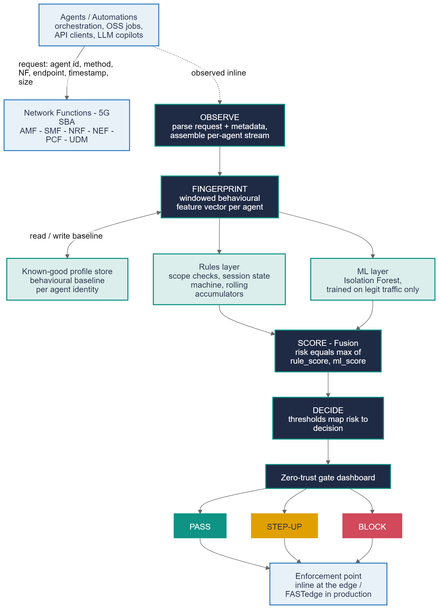

# AEGIS - Zero-Trust Identity for AI Agents on the Network

**5G Academy 2026 - Fastweb + Vodafone - Team 4**

**Live project page:** https://fauzan111.github.io/AEGIS/#gate1
**Live dashboard:** https://aegis5gacademy.streamlit.app/

## What AEGIS is, in plain terms

5G networks are increasingly run by automated programs, not people: orchestration bots, closed-loop automation, AI copilots that call the network's internal services directly. Each of these programs carries a credential, a password or token, to prove it's allowed to be there.

The problem: a credential only proves you *have* the right key. It says nothing about whether the thing holding that key right now is still behaving the way it's supposed to. If a credential gets stolen or a program gets compromised, it keeps walking through every door it's ever been allowed through, forever, because nothing ever checks again after the first login.

AEGIS is a security layer that watches *behaviour*, not just credentials. It builds a profile of how each automated program normally acts, how often it makes requests, what it asks for, in what order, and continuously compares new activity against that profile. A valid credential being used in an unusual way gets caught, even though the password itself was never wrong.

One line: **credentials prove what you have, AEGIS verifies how you behave.**

## How it works

Four steps, always running the same way:

1. **Observe** - every request a program makes gets logged: who, what, when, how.
2. **Fingerprint** - that turns into a behavioural profile for that program, its normal pace, its normal targets, its normal pattern.
3. **Score** - new activity is compared live against that profile, using two methods together: a set of fast, explainable rules, and a machine-learning model that learns what "normal" looks like without ever needing an example of an attack.
4. **Decide** - the combined score becomes one of three outcomes: **Pass** (behaves normally), **Step-up** (something looks slightly off, challenge it with a re-check), or **Block** (looks like a real attack, shut it down and alert the security team).

## What it catches

AEGIS is built to catch seven different ways a credential or automated program can be misused: pretending to be a different program, a program that's been quietly compromised and starts drifting from its own normal behaviour, reconnaissance (snooping around parts of the network it shouldn't), a sudden flood of requests, slow and quiet data theft over time, requests happening in the wrong order, and a program reaching into parts of the network it was never meant to touch.

Five of these seven map directly onto attacker techniques named in public industry threat frameworks (MITRE FiGHT, GSMA/ENISA 5G guidance); the other two are AEGIS's own behavioural contributions, stated plainly rather than forced into a fit. Full mapping: `docs/GATE-3/threat-model-external-mapping.md`.

## The results

Tested on a held-out set of real attack simulations the system never saw during training, across 7 different automated-agent profiles and 10 attack variants:

- **ROC-AUC 0.979** - a measure of how well the system separates real attacks from normal activity, out of a possible 1.0.
- **91.6% recall** - roughly 92 out of every 100 real attacks get caught.
- **1.44% false-positive rate** - innocent, normal activity gets wrongly flagged only about 1 in every 100 times.

Detection isn't a flat 100% across every threat, and that's deliberate: loud, obvious attacks (a sudden flood of requests, a program reaching somewhere it's never allowed) get caught every time, because those are near-certain signals. Quieter, subtler attacks (slow data theft, reconnaissance) are genuinely harder and sit lower, which matches how real-world security systems behave, not an inflated number that would look suspicious to anyone who's worked with real security data.

We also benchmarked against **Statistical Process Control (SPC)**, the classic, already-used-in-industry method for this kind of monitoring, reimplemented ourselves and run on the exact same data: SPC gets 0.929 ROC-AUC and 64.0% recall, AEGIS gets 0.979 and 91.6%. We checked that gap isn't just luck (statistically significant, not a fluke), and cross-validated the decision threshold across 5 different data splits to confirm it wasn't cherry-picked to one lucky test set.

Further statistical evidence - bootstrap confidence intervals, cross-validated threshold stability, a concept-drift check, and an adversarial stress test - is in `reports/GATE-2/`.

## Validated on a real 5G core, not just our own simulator

Everything above was measured on synthetic traffic we generated ourselves, which is honest but could, in theory, just mean the detector is good at scoring its own generator. To check that wasn't the case, we stood up a real Open5GS 5G core plus a real UERANSIM device, captured genuine signalling traffic off the wire, and ran AEGIS's own, unmodified detection code against it.

Two things it confirmed: our synthetic traffic's format matches real captured network traffic almost exactly, and the detector itself correctly flagged a real attack pattern on real traffic it had never seen before. Full runbook and results: `docs/GATE-3/real-traffic-capture.md`.

## See it live

The [live dashboard](https://aegis5gacademy.streamlit.app/) runs the real detection pipeline in real time: pick one of the seven attack types, launch it, and watch the system score it, explain in plain language why it flagged what it flagged, and sort it into pass, step-up, or block, live.

## Team

Fauzan Ejaz (Captain) - Llagami Tedi

## Project structure

- `docs/` - written reports, threat model and architecture documentation, the real-traffic-capture runbook
- `slides/` - presentation decks and official report submissions
- `reports/` - evaluation charts, metrics, the architecture diagram, and the statistical evidence suite
- `src/` - source code for the traffic generator, the detector, the dashboard, and the real-traffic capture/validation scripts
- `data/` - the synthetic dataset used for evaluation
